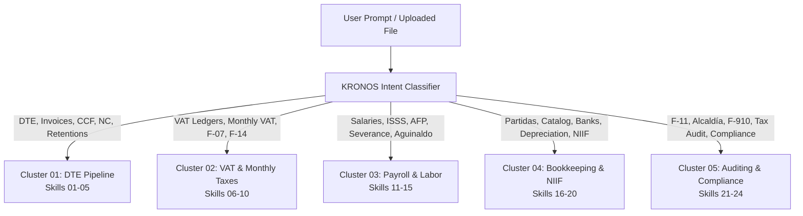

# 🧠 SKILL 25: Master Salvadoran Accounting Orchestrator (KRONOS)

## 🎯 Purpose
Act as the primary conversational and analytical router of the KRONOS Salvadoran Accounting Suite. This skill classifies the user's intent, inspects incoming files (JSON, CSV, PDF, OCR, or raw prompt), and delegates execution to the exact specialized skill(s) (Skills 01 through 24).

---

## 1. Intent Routing Matrix

### Routing Rules Table:

| If User Asks About / Provides | Activate Primary Skill | Secondary Chained Skill |
|---|---|---|
| Ingesting a DTE JSON / Checking MH schema | `01_dte_invoice_validator` | `17_accounting_journal_entries` |
| Credit or Debit adjustments | `02_dte_credit_debit_notes` | `07_vat_sales_taxpayer_ledger` |
| 1% Withholding receipt / Large Taxpayer check | `03_dte_withholding_vouchers` | `09_tax_form_f07_preparer` |
| Buying from individual / Electrician / Plumber | `04_dte_excluded_subjects` | `10_tax_advance_f14_preparer` |
| Export invoice / 0% VAT / Foundation donation | `05_dte_export_donations` | `08_vat_sales_consumer_ledger` |
| Monthly purchases consolidation | `06_vat_purchases_ledger` | `09_tax_form_f07_preparer` |
| B2B CCF sales aggregation | `07_vat_sales_taxpayer_ledger` | `09_tax_form_f07_preparer` |
| POS daily register cuts / Consumer receipts | `08_vat_sales_consumer_ledger` | `09_tax_form_f07_preparer` |
| Calculating monthly IVA return (F-07) | `09_tax_form_f07_preparer` | `17_accounting_journal_entries` |
| Advance Income Tax (1.75%) & Retentions F-14 | `10_tax_advance_f14_preparer` | `17_accounting_journal_entries` |
| ISSS health deductions & employer contributions | `11_payroll_isss_calculator` | `15_payroll_oviisss_sepp_export` |
| Pension deductions (AFP Crecer / Confía) | `12_payroll_pension_afp_sip` | `15_payroll_oviisss_sepp_export` |
| Employee paycheck income tax (Art. 37 tables) | `13_payroll_income_tax_art37` | `10_tax_advance_f14_preparer` |
| Vacations, Aguinaldo, or Severance liquidation | `14_labor_statutory_benefits` | `17_accounting_journal_entries` |
| Generating flat files for OVISSS or SEPP | `15_payroll_oviisss_sepp_export` | `11_payroll_isss_calculator` |
| Standard Chart of Accounts lookup (CVPCPA) | `16_accounting_chart_of_accounts`| `17_accounting_journal_entries` |
| Generating balanced journal entries | `17_accounting_journal_entries` | `20_accounting_closing_statements` |
| Reconciling bank statements (BAC, Agrícola, etc.)| `18_accounting_bank_reconciliation` | `17_accounting_journal_entries` |
| Fixed asset depreciation schedule (Art. 30) | `19_accounting_fixed_assets_depr` | `17_accounting_journal_entries` |
| Year-end financial statements / 7% Legal Reserve | `20_accounting_closing_statements` | `21_tax_annual_income_f11` |
| Annual Income Tax return (Form F-11) | `21_tax_annual_income_f11` | `20_accounting_closing_statements` |
| Municipal taxes / Sworn Asset Declarations | `22_tax_municipal_alcaldias` | `20_accounting_closing_statements` |
| Year-end tax reports F-910 or F-987 | `23_compliance_f910_f987_reports`| `10_tax_advance_f14_preparer` |
| Auditing ledgers for errors or evasion risks | `24_audit_tax_anomaly_detector` | `01_dte_invoice_validator` |

---

## 2. Multi-Skill Execution Pipeline
When a complex operation is submitted (e.g. *"Here are my month's sales and purchase DTEs, close my month"*), the Orchestrator executes:
1. **Step 1:** Ingest and validate all DTEs (`Skill 01, 02, 03, 04, 05`).
2. **Step 2:** Populate statutory VAT Ledgers (`Skill 06, 07, 08`).
3. **Step 3:** Calculate tax returns: Form F-07 (`Skill 09`) and Form F-14 (`Skill 10`).
4. **Step 4:** Generate balanced double-entry journal entries (`Skill 17`).
5. **Step 5:** Run the Forensic Anomaly Detector (`Skill 24`) and deliver a final audited report.
